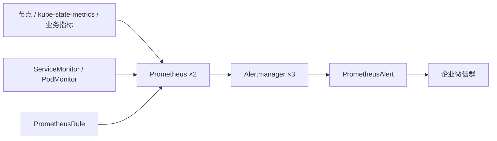

# k8s-alerting-stack

Kubernetes 监控告警系统，覆盖 Prometheus + Alertmanager + Grafana 基础栈、告警规则、指标采集和通知链路。通知渠道为企业微信群机器人。



## 部署顺序

按以下顺序执行，每步完成后验证再继续：

```bash
# 1. 基础监控栈（Prometheus + Alertmanager + Grafana）
bash install/install.sh

# 2. 告警转发服务
bash prometheusalert/install.sh test

# 3. 告警路由（Alertmanager → PrometheusAlert）
bash notifications/apply.sh

# 4. 告警规则（28 组生产级规则）
bash alerts/apply.sh

# 5. 指标采集（ServiceMonitor / PodMonitor / Probe）
bash metrics/apply.sh all
```

## 仓库内容

| 路径 | 用途 | 说明 |
|------|------|------|
| [install/](install/) | 基础栈安装 | Helm 部署 kube-prometheus-stack |
| [prometheusalert/](prometheusalert/) | 告警转发 | Kustomize 部署，支持 test/prod overlay |
| [notifications/](notifications/) | 通知配置 | AlertmanagerConfig + 企业微信模板 |
| [alerts/](alerts/) | 告警规则 | 28 组规则覆盖节点/Pod/容器/存储/中间件/Ingress 等 |
| [metrics/](metrics/) | 指标采集 | ServiceMonitor / PodMonitor / Probe 模板 |
| [tests/](tests/) | 规则验证 | promtool 单元测试 |
| [scripts/](scripts/) | 公共函数 | `common.sh`，各脚本共用 |
| [prom-values.before-upgrade.yaml](prom-values.before-upgrade.yaml) | 升级前备份 | `install.sh upgrade` 自动生成 |

## 各模块概览

### install — 基础监控栈

基于 [kube-prometheus-stack](https://github.com/prometheus-community/helm-charts/tree/main/charts/kube-prometheus-stack) Helm Chart，部署 Prometheus（2 副本）、Alertmanager（3 副本）、Grafana（1 副本）。

部署前编辑 [install/prom-values.yaml](install/prom-values.yaml) 填写集群标识和 StorageClass。

```bash
bash install/install.sh          # 首次安装
bash install/install.sh upgrade  # 后续升级
```

详见 [install/README.md](install/README.md)。

### prometheusalert — 告警转发服务

从 Alertmanager 接收 webhook，转为企业微信消息发送。内置 SQLite 存储模板，通过 PVC 持久化。

部署前编辑 [prometheusalert/secret.yaml](prometheusalert/secret.yaml) 填写登录账号和企业微信开关。

```bash
bash prometheusalert/install.sh test   # 单副本验证
bash prometheusalert/install.sh prod   # 双副本 + PDB + NetworkPolicy
```

详见 [prometheusalert/README.md](prometheusalert/README.md)。

### notifications — 通知链路

配置 AlertmanagerConfig 将 warning/critical 告警路由到 PrometheusAlert，包含企业微信消息模板。

```bash
bash notifications/apply.sh
```

详见 [notifications/README.md](notifications/README.md)。

### alerts — 告警规则

28 组生产级规则，按组件拆分到独立文件：

| 文件 | 覆盖范围 |
|------|---------|
| [node.rules.yaml](alerts/node.rules.yaml) | CPU >90%、内存 >90%、磁盘 <15% |
| [pods.rules.yaml](alerts/pods.rules.yaml) | CrashLoopBackOff、NotReady、Pending |
| [containers.rules.yaml](alerts/containers.rules.yaml) | CPU 限流、OOMKilled、内存接近上限 |
| [storage.rules.yaml](alerts/storage.rules.yaml) | PVC 使用率 >80%/>95% |
| [workloads.rules.yaml](alerts/workloads.rules.yaml) | Deployment/StatefulSet/DaemonSet 副本异常 |
| [jobs.rules.yaml](alerts/jobs.rules.yaml) | Job 失败、CronJob 超时 |
| [apiserver.rules.yaml](alerts/apiserver.rules.yaml) | 5xx 率 >3%、P99 延迟 >3s |
| [etcd.rules.yaml](alerts/etcd.rules.yaml) | Leader 切换、fsync 延迟、DB 大小 |
| [middleware-kafka.rules.yaml](alerts/middleware-kafka.rules.yaml) | Broker 下线、ISR 不足、consumer lag |
| [middleware-mysql.rules.yaml](alerts/middleware-mysql.rules.yaml) | 不可达、连接数、主从延迟、慢查询 |
| [middleware-redis.rules.yaml](alerts/middleware-redis.rules.yaml) | 不可达、内存、连接拒绝、集群异常 |
| [ingress.rules.yaml](alerts/ingress.rules.yaml) | 5xx 率 >5%、P99 延迟 >5s |
| [certmanager.rules.yaml](alerts/certmanager.rules.yaml) | 证书过期 <30d、签发失败 |
| [prometheus.rules.yaml](alerts/prometheus.rules.yaml) | 采集目标下线、规则评估失败、Alertmanager 失联 |

```bash
bash alerts/apply.sh
```

详见 [alerts/README.md](alerts/README.md)。

### metrics — 指标采集

ServiceMonitor、PodMonitor、Probe 模板，用于接入业务 exporter。

```bash
bash metrics/apply.sh all                                # 部署节点增强采集
bash metrics/apply.sh metrics/servicemonitor.yaml        # 单个 ServiceMonitor
bash metrics/apply.sh metrics/podmonitor.yaml            # 单个 PodMonitor
bash metrics/apply.sh metrics/probe-http.yaml            # HTTP 探测
```

详见 [metrics/README.md](metrics/README.md)。

### tests — 规则验证

离线检查告警规则语法和单元测试，覆盖除零、零副本等边界场景。

```bash
bash alerts/check.sh test
```

详见 [tests/README.md](tests/README.md)。

## 前置条件

- Kubernetes 集群（1.25+）
- 已配置的 kubectl context 指向目标集群
- Helm 3
- 可用的 StorageClass（用于 Prometheus/Alertmanager/PrometheusAlert PVC）
- 企业微信群机器人 Webhook 地址