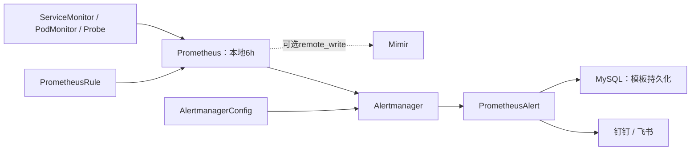

# k8s-alerting-stack

使用Helm安装Prometheus、Alertmanager、Grafana，后续用CRD分别管理指标采集、告警规则和通知路由。默认本地保留上限6h；Mimir远写可选，通知后续对接PrometheusAlert → 钉钉/飞书。

| 目录 | 文件/资源 | 如何更新 |
| --- | --- | --- |
| [install/](install/README.md) | Helm values、安装与回滚步骤 | 修改环境 values 后用 Helm upgrade；不手改 Helm 管理的 Prometheus CR |
| [metrics/](metrics/README.md) | ServiceMonitor / PodMonitor / Probe 示例 | 配好实际目标后 kubectl apply -f 单个文件 |
| [alerts/](alerts/README.md) | 15条增量告警、指标依赖和测试方法 | 按环境选择规则，promtool校验后apply对应文件 |
| [notifications/](notifications/README.md) | AlertmanagerConfig、PrometheusAlert 对接 | 先建URL Secret，再 apply 通知路由CR |
| [prometheusalert/](prometheusalert/README.md) | Kustomize base、test/prod、MySQL配置 | Secret准备后kubectl apply -k |
| [Mimir（可选）](install/mimir.md) | remote_write与认证 | 合并到环境values后Helm upgrade |
| tests/ | 告警边界测试 | 按 alerts/README 的命令执行 |

**执行顺序：基础安装 → 采集 → 告警 → PrometheusAlert部署 → 通知路由 → 联调。** 各文档命令在仓库根目录执行。示例中的REPLACE字段必须替换；没有部署的组件不要启用对应缺失检测。已有环境先核对原release/values/CRD，不直接照新装步骤覆盖。

固定Chart `92.17.1`，release `kps`，namespace `monitoring`。从 [安装文档](install/README.md) 开始：复制values、替换集群名和StorageClass、预览、安装、验证Prometheus/Alertmanager/Grafana。默认启用Prometheus 2副本、Alertmanager 3副本、Grafana 1副本；初装通知为空接收器，完成通知对接后才能发送群消息。

KPS基础规则复用，超出6h的API SLO组和参考环境不可达的控制面采集/规则暂关闭，细节见values注释。业务采集和告警仅启用已部署、已核对指标的组件。项目提供通用采集模板、15条增量告警、PrometheusAlert部署及通知接入；业务exporter、Blackbox、MySQL和Mimir本身需另备。

已完成离线验证：固定Chart的Helm lint/template、test/prod Kustomize渲染通过；默认规则窗口均≤6h；5份监控CR按Chart内CRD检查字段/类型/必填/枚举通过；15条业务告警通过promtool及5组单测；通知模板验证缺字段降级和混合触发/恢复。以上不等价于API准入或上线验收，现场仍需验证存储、MySQL与真实群消息。
