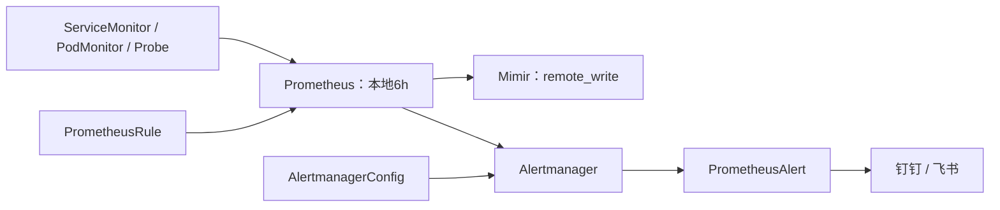

# k8s-alerting-stack

Helm 安装 kube-prometheus-stack，后续使用独立 CRD 管理**指标采集、告警规则和通知路由**。本地保留6h并评估告警，remote_write 写入 Mimir，通知经 PrometheusAlert 发往钉钉/飞书。不包含 kube-prometheus 0.14 基线。

| 目录 | 文件/资源 | 如何更新 |
| --- | --- | --- |
| [install/](install/README.md) | Helm values、安装与回滚步骤 | 修改环境 values 后用 Helm upgrade；不手改 Helm 管理的 Prometheus CR |
| [metrics/](metrics/README.md) | ServiceMonitor / PodMonitor / Probe 示例 | 配好实际目标后 kubectl apply -f 单个文件 |
| [alerts/](alerts/README.md) | 15条 PrometheusRule、指标依赖和测试方法 | promtool 校验后 kubectl apply -f alerts/business-alerts.yaml |
| [notifications/](notifications/README.md) | AlertmanagerConfig、PrometheusAlert 对接 | 先建URL Secret，再 apply 通知路由CR |
| tests/ | 告警边界测试 | 按 alerts/README 的命令执行 |

**执行顺序：安装 → 采集 → 告警 → 通知 → 联调。** 各文档命令在仓库根目录执行。示例中的 REPLACE 字段必须替换；没有部署的组件不要启用对应缺失检测。已有环境先核对原 release/values/CRD，不直接照新装步骤覆盖。

固定示例 Chart：92.17.1（Operator 0.94.2），声明 Kubernetes >=1.25。按安装文档使用 `helm install kps prometheus-community/kube-prometheus-stack -n monitoring --create-namespace -f prom-values.yaml --version 92.17.1`；先client dry-run预览，再安装并验收。Grafana随Chart启用，使用5Gi持久化存储，访问及初始密码见安装文档。KPS 自带规则保留，超出6h的长窗SLO组从本地关闭，另行放到 Mimir Ruler。

当前提供的是文档和配置示例：Mimir 地址/认证、StorageClass、资源大小、业务目标、实际 job 和 PrometheusAlert URL 都由环境填写。KPS 不会自动安装 Flink、Kafka、Doris、数据库 exporter、Blackbox 或 PrometheusAlert。

已完成离线验证：固定Chart的Helm lint/template通过；渲染默认规则窗口均≤6h；5份自管CR按该Chart内CRD检查字段/类型/必填/枚举通过（不等价于API准入校验）；15条业务告警通过promtool及5组单测。尚未执行目标集群server dry-run、安装或真实通知测试，现场按文档逐步验收。
