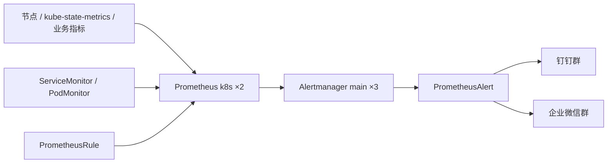

# k8s-alerting-stack

面向新 Kubernetes 环境复用的完整监控告警部署项目。以现网为参考，提取环境参数，形成可生成、可部署、可验证、可回滚的配置。通知渠道为钉钉群机器人和企业微信群机器人。

当前阶段：**现网配置采集与接管准备**。本仓库尚不是全新集群的一键安装包。已取得全量 ServiceMonitor、告警规则、关键选择器、现有企微路由和模板，并只读核对实际运行状态；仍缺完整存储、exporter 参数和通知中心配置，不能据此生成声称可直接替换现网的部署清单。

最终交付标准见 [跨环境复用设计与验收](docs/06-reuse-model.md)：新环境只填写环境配置和本地凭据，即可按步骤生成、校验、部署并验证两种通知渠道。现网采集是还原可复用配置的输入，不是项目的最终交付。



上图是目标链路。现网已确认通过 PrometheusAlert 发送企业微信；钉钉尚未配置，不能将图视为两个渠道均已上线。

## 从这里开始

**实际执行优先打开 [逐步验证操作手册](docs/05-step-by-step.md)，每次只做一个步骤，记录通过后再继续。**

各组件安装源、配置字段和模板入口见 [组件安装与配置手册](docs/10-component-installation.md)。当前处于只读核对阶段；组件模板尚未全部补齐，状态在手册末尾逐项列出。

1. 阅读 [现网基线](docs/01-current-state.md)，核对已知事实与问题。
2. 在现有管理机运行 [采集流程](docs/02-collection.md)，不修改集群。
3. 按 [待补配置](docs/03-open-items.md) 提供经过检查的资料，不提交凭据。
4. 按 [实施与验收流程](docs/04-rollout.md) 核对选择器、规则、模板、通知链路并逐项验收。

```bash
git clone https://github.com/sxxpqp/k8s-alerting-stack.git
cd k8s-alerting-stack
python3 scripts/collect.py
```

脚本要求 Python 3 和已配置权限的 kubectl，只执行读取命令。原始备份存入 `.local/`；它可能包含环境变量和内网信息，不能直接上传。

## 仓库内容

| 路径 | 用途 |
| --- | --- |
| docs/ | 现状、采集、待补项、验证和回滚步骤 |
| scripts/collect.py | 收集现有安装与关联配置，生成受限分享资料 |
| baseline/ingress-nginx-rule.yaml | 已上传规则的清理副本，作为比对基线，不是完整现网备份 |
| proposals/ingress-5xx-rule.yaml | 5xx 规则的候选修复，需要查询真实指标后再采用 |
| templates/prometheusalert-markdown.tmpl | 缺字段时回退的候选消息正文，尚需在现网 v4.9.2 页面测试 |

基线、候选修复和后续已验收配置分开管理。不要同时部署同名告警的旧、新规则。

## 验证状态

- 已有证据：资源清单、全量规则与 Monitor、现有企微路由/模板、HTTP Probe，以及 2026-11-04 的 Prometheus API 只读快照。详见 docs/07、08、09。
- 本地检查记录见 [验收流程](docs/04-rollout.md)。
- 已通过 Prometheus 入口只读确认 130 个活动 Target 均 UP、151 条告警加载且 health 正常，同时发现无目标/无指标的盲区。未部署配置、导入模板或发送测试消息；新环境安装、消息格式、去重与持久化仍待验证。
- 新环境安装与版本选型将在现网完整配置归档后编写；不从资源 labels 猜测运行版本，不使用未经核验的镜像标签。
